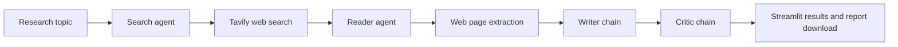

# LangChain Multi-Agent Research System

A research assistant that searches the web, extracts useful content from a relevant page, drafts a structured report, and asks a second language-model chain to review it. The project includes a Streamlit web interface for running the workflow and downloading the report as Markdown.

## Features

- Search the web for a user-provided research topic.
- Select and scrape a relevant search result for additional context.
- Generate a report with an introduction, key findings, conclusion, and sources.
- Review the report and return a score, strengths, and suggested improvements.
- View pipeline output in the Streamlit app and download the report as a `.md` file.

## Architecture



The workflow runs sequentially. The search agent uses Tavily to find sources; the reader agent chooses a relevant URL and calls the scraping tool. The scraper fetches the page with `requests` and extracts readable text using Trafilatura, Readability, and BeautifulSoup fallbacks. The writer and critic chains use the configured OpenAI chat model. The Streamlit UI displays the results and provides a Markdown download.

### Project layout

```text
.
├── app.py                  # Streamlit interface and UI-driven workflow
├── main.py                 # Example command-line pipeline entry point
├── requirements.txt        # Python dependencies
└── src/
    ├── agents/agents.py      # Search and reader agents; writer and critic chains
    ├── pipelines/pipeline.py # Reusable sequential research pipeline
    └── tools/tools.py        # Tavily search and web-page scraping tools
```

## Technologies

- **Python 3.11** — recommended runtime
- **Streamlit** — web application and report download UI
- **LangChain** and **LangChain OpenAI** — agents, prompts, and model integration
- **OpenAI GPT-4o mini** — language model used for research and report generation
- **Tavily** — web search API
- **Requests, Trafilatura, Readability, BeautifulSoup, and lxml** — page fetching and text extraction
- **python-dotenv** — loading local API keys from `.env`

## Installation

### 1. Clone the repository

```bash
git clone https://github.com/amazzuca/LangChain-Multi-Agent-Research-System.git
cd LangChain-Multi-Agent-Research-System
```

### 2. Create and activate a virtual environment

Python 3.11 is recommended.

**Windows PowerShell**

```powershell
py -3.11 -m venv .venv
.\.venv\Scripts\Activate.ps1
```

**macOS / Linux**

```bash
python3.11 -m venv .venv
source .venv/bin/activate
```

### 3. Install dependencies

```bash
python -m pip install --upgrade pip
python -m pip install -r requirements.txt
```

### 4. Configure API keys

Create a `.env` file in the repository root with your own API credentials:

```dotenv
OPENAI_API_KEY=your_openai_api_key
TAVILY_API_KEY=your_tavily_api_key
```

The OpenAI key is used by LangChain's `ChatOpenAI` integration, and the Tavily key enables web search. Keep `.env` private; it is excluded from version control. API usage may incur charges according to your provider accounts.

## Run the application

Start the Streamlit interface from the repository root:

```bash
streamlit run app.py
```

Open the local URL printed by Streamlit, enter a topic, and select **Run Research Pipeline**. The app shows search output, extracted page content, the generated report, and the critic's feedback. Use the download button to save the report as Markdown.

The pipeline can also be run from Python with `run_research_pipeline(topic)` in `src/pipelines/pipeline.py`. `main.py` is a small example script with a topic defined in the file; the Streamlit app is the interactive entry point.

## Configuration and notes

- The model is currently set to `gpt-4o-mini` in `src/agents/agents.py`.
- Search and scraping require internet access. Some websites may block automated requests or provide limited extractable content.
- Treat generated research as a starting point: verify important claims and source links independently.
- `requirements.txt` uses minimum dependency versions rather than a lock file, so newly installed environments may resolve newer compatible releases.

## Contributing

Contributions are welcome. To get started:

1. Fork the repository and create a branch for your change.
2. Install the project dependencies and make the change.
3. Run the application locally and verify the affected workflow.
4. Open a pull request describing the change and any relevant validation.

Please do not include API keys, `.env` files, or other credentials in commits or pull requests.

## License

This project is distributed under the Apache License 2.0. See [LICENSE](LICENSE) for details.
